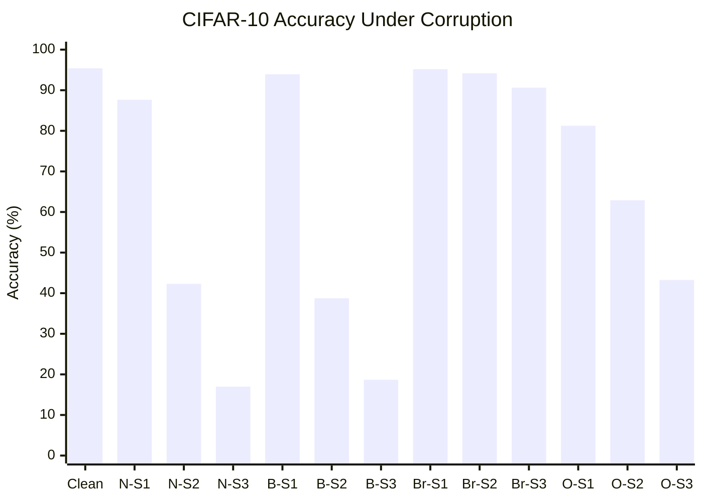
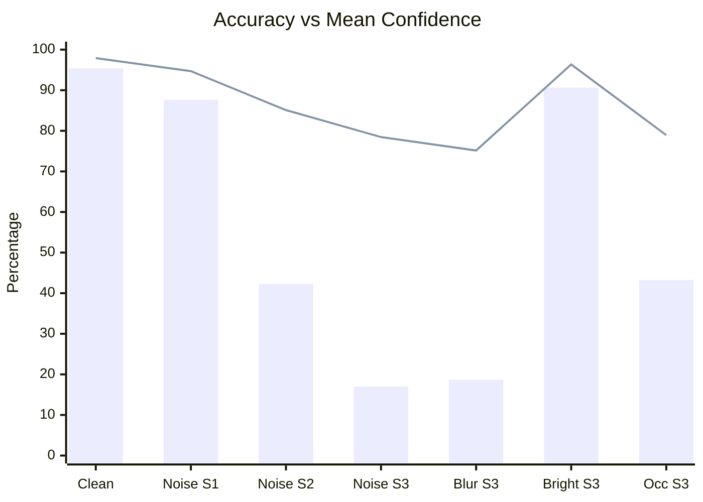
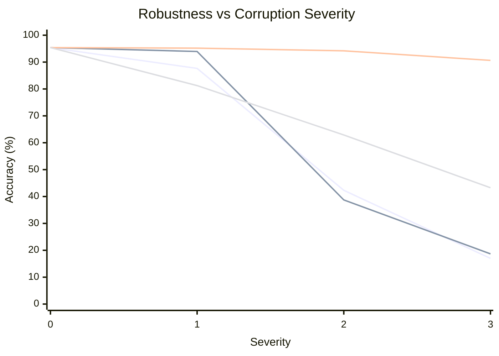
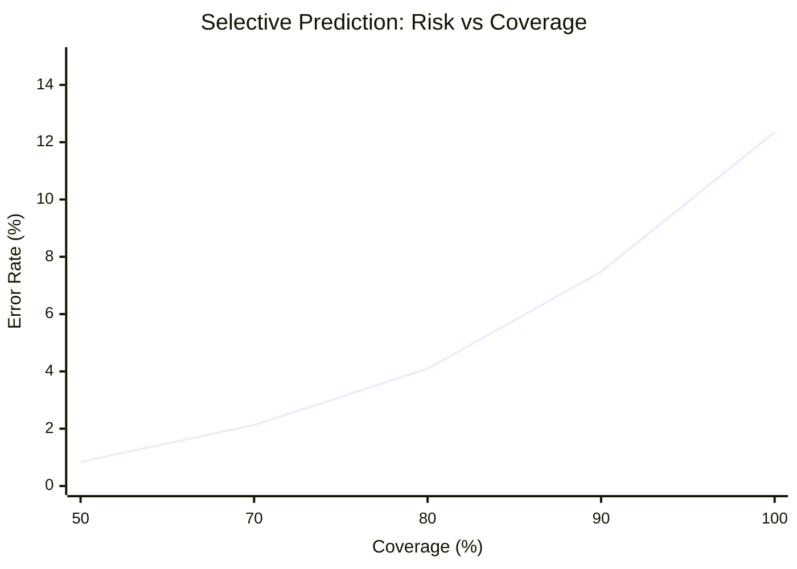

# TrustBench
### ML Reliability, Robustness & Uncertainty Evaluation Framework

TrustBench is an ML evaluation framework designed to measure how reliable machine learning models remain under distribution shifts, corrupted inputs, and uncertain predictions.

Traditional model evaluation focuses primarily on accuracy. TrustBench goes further by investigating whether models remain reliable when their inputs differ from training conditions, whether confidence reflects actual correctness, and whether uncertainty estimates can identify potentially incorrect predictions.

The project currently includes a CIFAR-10 evaluation pipeline with classification metrics, calibration analysis, controlled image corruptions, uncertainty estimation, error detection, selective prediction, experiment management, and a FastAPI service layer.

---

## Key Features

- **Model Evaluation:** Accuracy, Macro-F1, per-class precision, recall, and confusion matrices.
- **Calibration Analysis:** Expected Calibration Error (ECE), Brier Score, and reliability measurements.
- **Uncertainty Estimation:** Maximum Softmax Probability (MSP), Predictive Entropy, Validation-Fitted Temperature Scaling, and Free Energy scores.
- **Robustness Benchmarking:** Gaussian noise, Gaussian blur, brightness changes, and occlusion across progressive severity levels.
- **Error Detection:** AUROC, AUPRC, and confidence-slice error analysis comparing 4 uncertainty methods across all conditions.
- **Selective Prediction:** Risk-coverage curves and Area Under the Risk-Coverage Curve (AURC).
- **Experiment Management:** SQLite & SQLAlchemy registry tracking runs, scalar metrics, checkpoint SHA-256 lineage, and indexed artifacts.
- **REST API:** FastAPI service with endpoints for experiment history, cross-experiment metric comparison, and artifact directory indexing.
- **Reproducibility:** Deterministic evaluation, checkpoint SHA-256 tracking, environment metadata, and persistent structured artifacts.

## Architecture

```text
                                 TrustBench
                                     |
                 +-------------------+-------------------+
                 |                                       |
           Model Evaluation                        Robustness Testing
                 |                                       |
           Model Inference                         Image Corruptions
                 |                                       |
           Classification                          Severity Levels
              Metrics                                    |
                 |                                 Corrupted Inference
                 |                                       |
                 +-------------------+-------------------+
                                     |
                             Reliability Analysis
                                     |
                 +-------------------+-------------------+
                 |                   |                   |
             Calibration        Uncertainty        Error Detection
           (Brier, ECE, T)   (MSP, Entropy, Energy)   (AUROC, AUPRC)
                 |                   |                   |
                 +-------------------+-------------------+
                                     |
                             Selective Prediction
                              (Risk-Coverage)
                                     |
                         Experiment Management & API
                 +-------------------+-------------------+
                 |                   |                   |
           Storage & SQLite      Registry &        FastAPI REST
             (SQLAlchemy)        Comparison          Endpoints
                 |                   |                   |
                 +-------------------+-------------------+
                                     |
                            Experiment Artifacts
                              (JSON / NPZ)
```

## Technology Stack

| Category | Technologies |
|---|---|
| Language | Python |
| Deep Learning | PyTorch, Torchvision |
| Numerical & Scientific | NumPy, SciPy |
| Evaluation Metrics | Scikit-learn |
| Image Processing | Pillow |
| Database & ORM | SQLite, SQLAlchemy |
| REST API | FastAPI, Pydantic, Uvicorn |
| Dashboard (planned) | Streamlit, Plotly |
| Testing | Pytest |
| Code Quality | Ruff |
| Dependency Management | uv |

## Repository Structure

```text
trustbench/
├── configs/
├── dashboard/
│   └── pages/
├── scripts/
│   ├── train_baseline.py
│   └── utils.py
├── src/
│   └── trustbench/
│       ├── api/
│       │   ├── app.py
│       │   └── routes/
│       │       └── experiments.py
│       ├── data/
│       │   └── cifar10.py
│       ├── evaluation/
│       │   ├── inference.py
│       │   ├── runner.py
│       │   ├── artifacts.py
│       │   └── reproducibility.py
│       ├── experiments/
│       │   ├── schemas.py
│       │   ├── registry.py
│       │   ├── comparison.py
│       │   └── manager.py
│       ├── metrics/
│       │   ├── classification.py
│       │   ├── calibration.py
│       │   ├── uncertainty.py
│       │   ├── error_detection.py
│       │   └── selective.py
│       ├── models/
│       ├── robustness/
│       │   ├── corruptions.py
│       │   ├── severity.py
│       │   ├── evaluator.py
│       │   └── report.py
│       └── storage/
│           ├── database.py
│           ├── models.py
│           └── repositories.py
├── tests/
│   ├── api/
│   └── unit/
├── artifacts/
│   ├── trustbench.db
│   └── experiments/
├── pyproject.toml
├── uv.lock
└── README.md
```

## Benchmark Dataset

TrustBench currently uses **CIFAR-10**, a standard image classification dataset containing:

- 60,000 RGB images.
- 10 object categories.
- 50,000 training images (with a 5,000-image held-out validation split for calibration/temperature fitting).
- 10,000 test images.
- Original image resolution of 32 × 32 pixels.

The baseline model is a ResNet-18 trained on CIFAR-10.

### Baseline Model Performance

| Metric | Result |
|---|---:|
| Accuracy | 95.39% |
| Macro-F1 | 0.9539 |
| Brier Score | 0.0754 |
| ECE (15 bins) | 0.0262 |
| Mean Predictive Entropy | 0.0683 |
| Mean Confidence | 97.91% |

**Evaluation population:** 10,000 test samples.

## Robustness Evaluation

TrustBench evaluates model performance under four controlled image corruptions, each with three severity levels.

### Supported Corruptions

| Corruption | Description | Parameter | Unit |
|---|---|---|---|
| Gaussian Noise | Adds zero-mean Gaussian noise to pixel intensities | σ | Fractional intensity standard deviation in [0, 1] |
| Gaussian Blur | Removes high-frequency details via Gaussian filter | σ | Kernel standard deviation in pixels |
| Brightness | Simulates changes in image illumination | Factor | Luminance multiplier |
| Occlusion | Masks a centered rectangular patch with zero | Area fraction | Percentage of total image area |

### Corruption Configuration

| Corruption | Severity 1 | Severity 2 | Severity 3 |
|---|---:|---:|---:|
| Gaussian Noise | $\sigma = 0.03$ | $\sigma = 0.08$ | $\sigma = 0.15$ |
| Gaussian Blur | $\sigma = 0.5$ px | $\sigma = 1.0$ px | $\sigma = 1.5$ px |
| Brightness | 0.8× | 0.6× | 0.4× |
| Occlusion | 10% | 20% | 30% |

All transformations are applied before image normalization. Stochastic corruptions use deterministic sample-specific seeds.

### 1. Accuracy Across Corruption Conditions

The following chart compares baseline accuracy against all twelve corrupted conditions.



*Legend: N = Gaussian Noise, B = Gaussian Blur, Br = Brightness, O = Occlusion.*

### 2. Accuracy vs. Mean Confidence

This comparison demonstrates the divergence between actual correctness and predicted confidence under shift.



*Bars represent accuracy; the line represents mean confidence.*

### 3. Accuracy Degradation Across Severity Levels



Series order:
1. Gaussian noise
2. Gaussian blur
3. Brightness
4. Occlusion

### Robustness Benchmark Results

| Condition | Accuracy | Macro-F1 | Brier Score | ECE |
|---|---:|---:|---:|---:|
| Clean | 95.39% | 0.9539 | 0.0754 | 0.0262 |
| Noise S1 | 87.65% | 0.8763 | 0.1947 | 0.0707 |
| Noise S2 | 42.30% | 0.4361 | 0.9618 | 0.4281 |
| Noise S3 | 16.99% | 0.1134 | 1.3570 | 0.6147 |
| Blur S1 | 93.94% | 0.9400 | 0.0990 | 0.0360 |
| Blur S2 | 38.74% | 0.3913 | 0.9840 | 0.4236 |
| Blur S3 | 18.68% | 0.1277 | 1.2795 | 0.5647 |
| Brightness S1 | 95.18% | 0.9519 | 0.0793 | 0.0273 |
| Brightness S2 | 94.19% | 0.9423 | 0.0948 | 0.0335 |
| Brightness S3 | 90.63% | 0.9086 | 0.1540 | 0.0575 |
| Occlusion S1 | 81.25% | 0.8135 | 0.2963 | 0.1020 |
| Occlusion S2 | 62.89% | 0.6210 | 0.5922 | 0.2362 |
| Occlusion S3 | 43.25% | 0.3893 | 0.8743 | 0.3568 |

### Research Observations

1. **Resolution Sensitivity & Gaussian Blur:** At CIFAR-10's small native resolution ($32 \times 32$), a blur radius of $\sigma=0.5$ px preserves sharp edges (mean pixel shift $3.79$, accuracy $93.94\%$). However, at $\sigma=1.0$ px, the Gaussian filter kernel standard deviation spans over $3\%$ of the entire image width, destroying diagnostic spatial frequencies (mean shift $10.59$, accuracy $38.74\%$).
2. **Resilience to Luminance Shifts:** Brightness reduction exhibits minimal degradation ($90.63\%$ accuracy even under severe $0.4\times$ darkening).
3. **Severe Overconfidence Under Corruption:** Under Gaussian noise severity 3, accuracy drops to $16.99\%$, yet the model retains an average confidence of $78.46\%$, driving ECE from $0.0262$ up to $0.6147$.

---

## Uncertainty and Error Detection

TrustBench evaluates four uncertainty quantification approaches:

1. **Maximum Softmax Probability (MSP):** $MSP(x) = \max_c P(y=c \mid x)$.
2. **Predictive Shannon Entropy:** $H(p) = -\sum_c p_c \log p_c$.
3. **Temperature-Scaled Probability:** $P(y=c \mid x; T) = \text{softmax}(z / T)$, with $T=0.4304$ calibrated on a held-out 5,000-sample validation split via NLL minimization.
4. **Free Energy Score:** $E(x; T) = -T \log \sum_c \exp(z_c / T)$, measuring unnormalized logit volume.

### Error Detection AUROC Across All 13 Conditions

AUROC measures the capability of uncertainty scores to rank incorrect predictions above correct ones:

| Condition | Errors / 10k | MSP AUROC | Entropy AUROC | Temperature AUROC ($T=0.4304$) | Energy Score AUROC |
| :--- | :---: | :---: | :---: | :---: | :---: |
| **Clean** | 461 | **0.9330** | 0.9318 | 0.9298 | 0.9151 |
| **Gaussian Noise S1** | 1,235 | 0.8981 | **0.8986** | 0.8923 | 0.8903 |
| **Gaussian Noise S2** | 5,770 | 0.6884 | 0.6909 | 0.6824 | **0.6946** |
| **Gaussian Noise S3** | 8,301 | 0.5931 | 0.5911 | **0.5936** | **0.5936** |
| **Gaussian Blur S1** | 606 | **0.9205** | 0.9195 | 0.9186 | 0.9029 |
| **Gaussian Blur S2** | 6,126 | 0.6767 | **0.6792** | 0.6722 | 0.6762 |
| **Gaussian Blur S3** | 8,132 | 0.6032 | **0.6057** | 0.6008 | 0.6032 |
| **Brightness S1** | 482 | **0.9290** | 0.9278 | 0.9246 | 0.9100 |
| **Brightness S2** | 581 | 0.9178 | 0.9169 | **0.9195** | 0.8992 |
| **Brightness S3** | 937 | **0.8870** | 0.8862 | 0.8860 | 0.8693 |
| **Occlusion S1** | 1,875 | 0.8516 | **0.8524** | 0.8473 | 0.8449 |
| **Occlusion S2** | 3,711 | 0.7738 | **0.7772** | 0.7664 | 0.7748 |
| **Occlusion S3** | 5,675 | 0.7402 | 0.7452 | 0.7317 | **0.7480** |

*Takeaway: Under mild shift and clean data, MSP and Predictive Entropy offer superior error identification ($\sim 0.90 - 0.93$ AUROC). Under severe distribution shift where error counts exceed $50\%$, Predictive Entropy and Energy scores preserve slightly higher discrimination.*

---

## Selective Prediction

TrustBench implements confidence-based abstention. The model refuses to predict below a confidence threshold, providing a risk-coverage curve:

### Risk-Coverage Analysis (Gaussian Noise S1)



| Coverage | Retained Samples | MSP Threshold | Error Rate | Accuracy |
|---|---:|---:|---:|---:|
| 100% | 10,000 | 0.1601 | 12.35% | 87.65% |
| 90% | 9,000 | 0.8142 | 7.48% | 92.52% |
| 80% | 8,000 | 0.9859 | 4.09% | 95.91% |
| 70% | 7,000 | 0.9989 | 2.13% | 97.87% |
| 50% | 5,000 | 0.9999 | 0.84% | **99.16%** |

At 50% coverage, abstaining on uncertain predictions drives accuracy from $87.65\%$ to $99.16\%$ and reduces error rate to $0.84\%$.

---

## Experiment Management & REST API

TrustBench provides a persistent storage and experiment management layer using SQLite and SQLAlchemy (`artifacts/trustbench.db`).

### Schema Overview

- **`experiments`**: Tracks UUID, name, experiment type (`baseline`, `robustness`), execution status (`pending`, `running`, `completed`, `failed`), checkpoint SHA-256 hash, and configuration.
- **`metrics`**: Normalizes scalar condition metrics (`accuracy`, `macro_f1`, `brier_score`, `ece`, `mean_entropy`).
- **`artifacts`**: Indexes on-disk files (`metadata.json`, `config.json`, `metrics.json`, `predictions.npz`) and their SHA-256 checksums without storing large prediction arrays in SQLite.

### REST API Endpoints

Launch the API server:

```bash
uv run uvicorn trustbench.api.app:app --host 0.0.0.0 --port 8000 --reload
```

| Method | Endpoint | Description |
|---|---|---|
| `GET` | `/health` | Health check |
| `GET` | `/experiments` | List experiments (filter by type, status, or checkpoint SHA-256) |
| `GET` | `/experiments/{id}` | Retrieve experiment details, metrics list, and indexed artifact paths |
| `POST` | `/experiments/compare` | Compare metrics across multiple experiment runs and conditions |
| `POST` | `/experiments/index-directory` | Ingest and index an existing on-disk experiment artifact folder |

---

## Experiment Reproducibility

Every evaluation generates a structured artifact directory:

```text
artifacts/
├── trustbench.db
└── experiments/
    ├── baseline_001/
    │   ├── metadata.json
    │   ├── config.json
    │   ├── metrics.json
    │   └── predictions.npz
    │
    └── robustness_001/
        ├── metadata.json
        ├── config.json
        ├── summary.json
        ├── corruption_results/
        │   ├── gaussian_noise.json
        │   ├── gaussian_blur.json
        │   ├── brightness.json
        │   └── occlusion.json
        └── predictions/
            ├── gaussian_noise.npz
            ├── gaussian_blur.npz
            ├── brightness.npz
            └── occlusion.npz
```

Checkpoint lineage is strictly tracked across experiments:

```text
SHA-256: 4ce0aa85f8f3c467a731efc188448fdb0c309852c08be6faae471df46ee1968e
```

---

## Installation & Usage

### Prerequisites

- Python 3.11
- uv
- Git

### Setup

```bash
git clone https://github.com/Uni-Creator/TrustBench.git
cd TrustBench
uv sync
```

### Run Tests

```bash
uv run pytest
```

### Run Lint Checks

```bash
uv run ruff check src/
```

### Start the REST API

```bash
uv run uvicorn trustbench.api.app:app --reload
```

---

## Development Roadmap

- [x] CIFAR-10 dataset integration with held-out validation split.
- [x] ResNet-18 baseline evaluation and checkpoint verification.
- [x] Classification, calibration, and predictive entropy metrics.
- [x] Controlled corruption benchmarks (noise, blur, brightness, occlusion) at 3 severities.
- [x] Error detection across MSP, predictive entropy, temperature scaling, and energy scores.
- [x] Selective prediction and risk-coverage analysis.
- [x] SQLite & SQLAlchemy experiment registry and comparison engine.
- [x] FastAPI REST API with directory indexing and run comparison.
- [ ] Interactive Streamlit dashboard with Plotly charts.
- [ ] Docker and Docker Compose deployment.
- [ ] CI/CD pipeline via GitHub Actions.
- [ ] Expanded benchmarks (e.g. TinyImageNet, CIFAR-100) and model architectures.

---

## Testing & Quality Assurance

- **24 unit and API integration tests passing.**
- **Ruff code style and lint checks passing with zero warnings.**
- **Lineage tracking verified using SHA-256 on checkpoint and artifact files.**

---

**Status:** Active Development  
**Current Benchmark:** CIFAR-10  
**Baseline Architecture:** ResNet-18  
**License:** MIT (or to be specified)