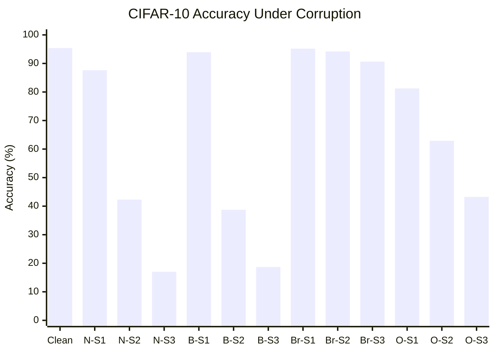
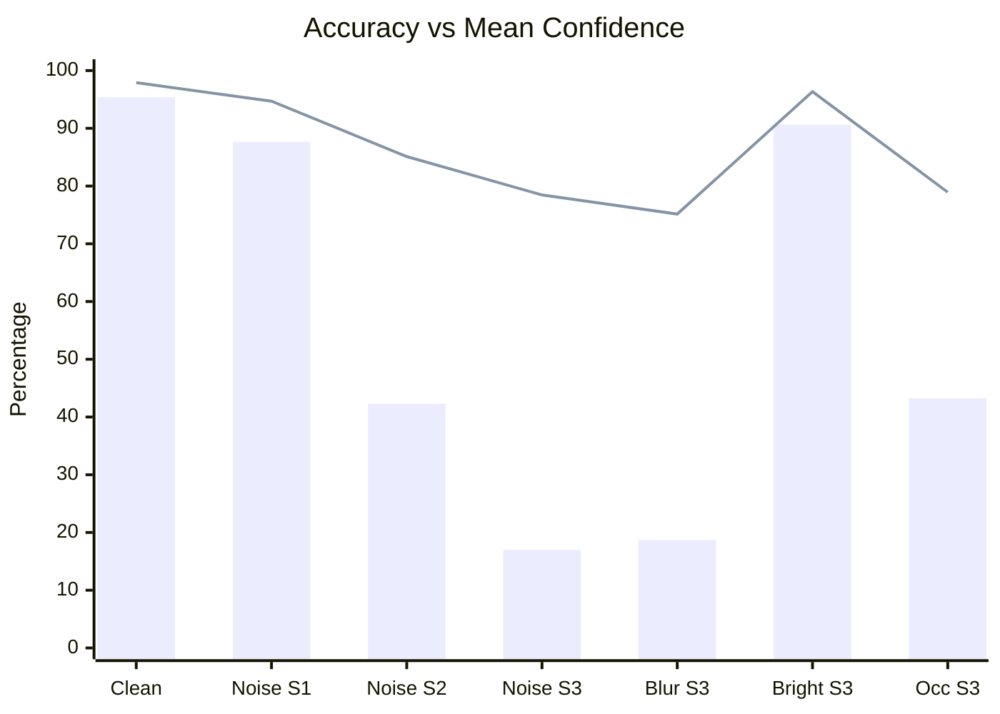
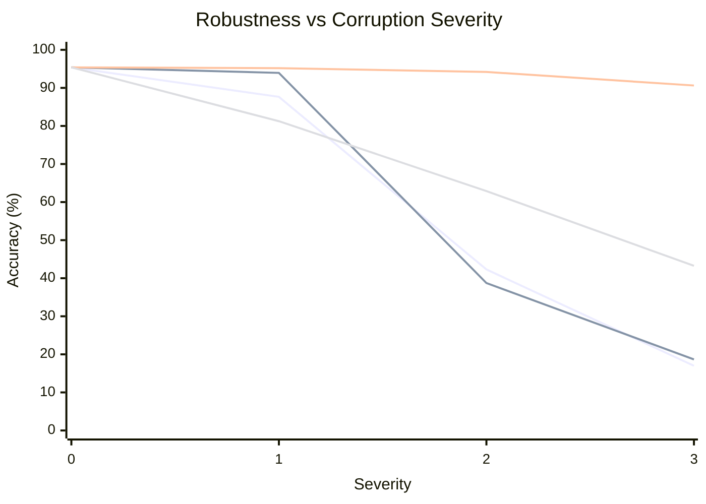
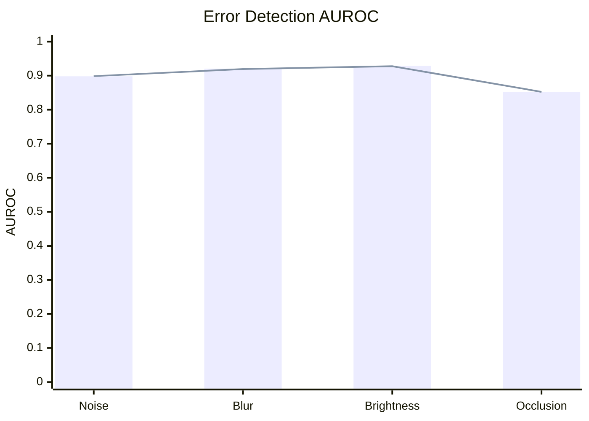
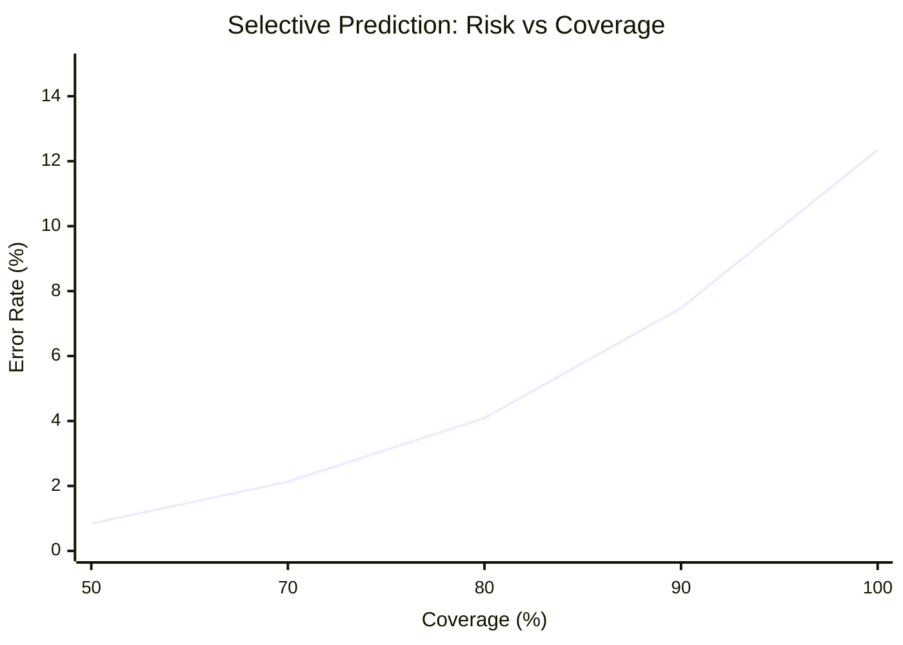

# TrustBench
### ML Reliability, Robustness & Uncertainty Evaluation Framework

TrustBench is an ML evaluation framework designed to measure how reliable machine learning models remain under distribution shifts, corrupted inputs, and uncertain predictions.

Traditional model evaluation focuses primarily on accuracy. TrustBench goes further by investigating whether models remain reliable when their inputs differ from training conditions, whether confidence reflects actual correctness, and whether uncertainty estimates can identify potentially incorrect predictions.

The project currently includes a CIFAR-10 evaluation pipeline with classification metrics, calibration analysis, controlled image corruptions, uncertainty estimation, error detection, and selective prediction.

---

## Key Features

- **Model Evaluation:** Accuracy, Macro-F1, per-class precision, recall, and confusion matrices.
- **Calibration Analysis:** Expected Calibration Error (ECE), Brier Score, and reliability measurements.
- **Uncertainty Estimation:** Predictive entropy and Maximum Softmax Probability (MSP).
- **Robustness Benchmarking:** Gaussian noise, Gaussian blur, brightness changes, and occlusion.
- **Error Detection:** AUROC, AUPRC, and confidence-based error analysis.
- **Selective Prediction:** Risk-coverage curves and Area Under the Risk-Coverage Curve (AURC).
- **Reproducibility:** Deterministic evaluation, checkpoint SHA-256 tracking, environment metadata, and experiment artifacts.

## Architecture

```text
                 TrustBench
                      |
          +-----------+-----------+
          |                       |
    Model Evaluation        Robustness Testing
          |                       |
    Model Inference         Image Corruptions
          |                       |
    Classification          Severity Levels
       Metrics                    |
          |                 Corrupted Inference
          |                       |
          +-----------+-----------+
                      |
              Reliability Analysis
                      |
          +-----------+-----------+
          |           |           |
      Calibration  Uncertainty  Error Detection
          |           |           |
          +-----------+-----------+
                      |
              Selective Prediction
                      |
              Experiment Artifacts
```

## Technology Stack

| Category | Technologies |
|---|---|
| Language | Python |
| Deep Learning | PyTorch, Torchvision |
| Numerical Computing | NumPy |
| Evaluation Metrics | Scikit-learn |
| Image Processing | Pillow |
| API (planned) | FastAPI |
| Dashboard (planned) | Streamlit, Plotly |
| Testing | Pytest |
| Code Quality | Ruff |
| Dependency Management | uv |

## Repository Structure

```text
trustbench/
├── configs/
├── dashboard/
│   └── pages/
├── scripts/
│   ├── train_baseline.py
│   └── utils.py
├── src/
│   └── trustbench/
│       ├── api/
│       │   └── routes/
│       ├── data/
│       │   └── cifar10.py
│       ├── evaluation/
│       │   ├── inference.py
│       │   ├── runner.py
│       │   ├── artifacts.py
│       │   └── reproducibility.py
│       ├── metrics/
│       │   ├── classification.py
│       │   ├── calibration.py
│       │   ├── uncertainty.py
│       │   ├── error_detection.py
│       │   └── selective.py
│       ├── models/
│       ├── robustness/
│       │   ├── corruptions.py
│       │   ├── severity.py
│       │   ├── evaluator.py
│       │   └── report.py
│       └── storage/
├── tests/
│   ├── api/
│   └── unit/
├── artifacts/
│   └── experiments/
├── pyproject.toml
├── uv.lock
└── README.md
```

## Benchmark Dataset

TrustBench currently uses **CIFAR-10**, a standard image classification dataset containing:

- 60,000 RGB images.
- 10 object categories.
- 50,000 training images.
- 10,000 test images.
- Original image resolution of 32 × 32 pixels.

The baseline model is a ResNet-18 trained on CIFAR-10.

### Baseline Model Performance

| Metric | Result |
|---|---:|
| Accuracy | 95.39% |
| Macro-F1 | 0.9539 |
| Brier Score | 0.0754 |
| ECE (15 bins) | 0.0262 |
| Mean Predictive Entropy | 0.0683 |
| Mean Confidence | 97.91% |

**Evaluation population:** 10,000 test samples.

## Robustness Evaluation

TrustBench evaluates model performance under four controlled image corruptions, each with three severity levels.

### Supported Corruptions

| Corruption | Description | Parameter |
|---|---|---|
| Gaussian Noise | Adds zero-mean Gaussian noise to pixel intensities | σ |
| Gaussian Blur | Removes high-frequency image details | σ |
| Brightness | Simulates changes in image illumination | Multiplier |
| Occlusion | Masks a portion of the input image | Area fraction |

### Corruption Configuration

| Corruption | Severity 1 | Severity 2 | Severity 3 |
|---|---:|---:|---:|
| Gaussian Noise | 0.03 | 0.08 | 0.15 |
| Gaussian Blur | 0.5 | 1.0 | 1.5 |
| Brightness | 0.8× | 0.6× | 0.4× |
| Occlusion | 10% | 20% | 30% |

All transformations are applied before image normalization. Stochastic corruptions use deterministic sample-specific seeds.

### 1. Accuracy Across Corruption Conditions

The following chart compares baseline accuracy against all twelve corrupted conditions.



*Legend: N = Gaussian Noise, B = Gaussian Blur, Br = Brightness, O = Occlusion.*

### 2. Accuracy vs. Mean Confidence

This comparison demonstrates the difference between actual correctness and predicted confidence.



*Bars represent accuracy; the line represents mean confidence.*

### 3. Accuracy Degradation Across Severity Levels



Series order:
1. Gaussian noise
2. Gaussian blur
3. Brightness
4. Occlusion

### Robustness Benchmark Results

| Condition | Accuracy | Macro-F1 | Brier | ECE |
|---|---:|---:|---:|---:|
| Clean | 95.39% | 0.9539 | 0.0754 | 0.0262 |
| Noise S1 | 87.65% | 0.8763 | 0.1947 | 0.0707 |
| Noise S2 | 42.30% | 0.4361 | 0.9618 | 0.4281 |
| Noise S3 | 16.99% | 0.1134 | 1.3570 | 0.6147 |
| Blur S1 | 93.94% | 0.9400 | 0.0990 | 0.0360 |
| Blur S2 | 38.74% | 0.3913 | 0.9840 | 0.4236 |
| Blur S3 | 18.68% | 0.1277 | 1.2795 | 0.5647 |
| Brightness S1 | 95.18% | 0.9519 | 0.0793 | 0.0273 |
| Brightness S2 | 94.19% | 0.9423 | 0.0948 | 0.0335 |
| Brightness S3 | 90.63% | 0.9086 | 0.1540 | 0.0575 |
| Occlusion S1 | 81.25% | 0.8135 | 0.2963 | 0.1020 |
| Occlusion S2 | 62.89% | 0.6210 | 0.5922 | 0.2362 |
| Occlusion S3 | 43.25% | 0.3893 | 0.8743 | 0.3568 |

### Initial Findings

**1. Sensitivity to Gaussian noise and blur**

The model experiences substantial performance degradation under severe noise and blur.

- Gaussian noise reduces accuracy from 95.39% to 16.99%.
- Gaussian blur reduces accuracy from 95.39% to 18.68%.

**2. Relative resilience to brightness changes**

Brightness corruption produces comparatively smaller degradation, with 90.63% accuracy at severity 3.

**3. Overconfidence under distribution shift**

Under Gaussian noise severity 3:

- Accuracy: 16.99%
- Mean confidence: 78.46%
- ECE: 0.6147

This demonstrates that high prediction confidence does not necessarily indicate reliable predictions under corrupted inputs.

## Uncertainty and Error Detection

TrustBench implements two uncertainty estimation approaches.

### Maximum Softmax Probability (MSP)

Measures the highest predicted class probability:

\[
MSP(x)=\max_c P(y=c\mid x)
\]

Lower maximum probability indicates greater predictive uncertainty.

### Predictive Entropy

Measures uncertainty across the predicted class distribution:

\[
H(p)=-\sum_{c=1}^{C}p_c\log(p_c)
\]

Higher entropy indicates a more distributed probability prediction.

### 4. Error Detection Performance

The following chart compares the ability of MSP and predictive entropy to distinguish correct predictions from incorrect predictions.



*Bars represent MSP AUROC; the line represents entropy AUROC.*

| Condition | MSP AUROC | Entropy AUROC |
|---|---:|---:|
| Gaussian Noise S1 | 0.8981 | 0.8986 |
| Gaussian Blur S1 | 0.9205 | 0.9195 |
| Brightness S1 | 0.9290 | 0.9278 |
| Occlusion S1 | 0.8516 | 0.8524 |

These results indicate that both confidence and entropy can distinguish correct from incorrect predictions to varying degrees under the tested corruptions.

## Selective Prediction

TrustBench implements confidence-based abstention.

Instead of forcing a prediction for every input, the system can reject uncertain predictions and retain only those exceeding a confidence threshold.

### 5. Risk-Coverage Analysis

Results for Gaussian Noise Severity 1:



| Coverage | Retained Samples | Accuracy | Error Rate |
|---|---:|---:|---:|
| 100% | 10,000 | 87.65% | 12.35% |
| 90% | 9,000 | 92.52% | 7.48% |
| 80% | 8,000 | 95.91% | 4.09% |
| 70% | 7,000 | 97.87% | 2.13% |
| 50% | 5,000 | 99.16% | 0.84% |

At 50% coverage, the model achieves 99.16% accuracy on retained predictions.

This illustrates the potential of selective prediction for reducing errors when abstention is an acceptable system behavior.

## Evaluation Metrics

| Metric | Purpose |
|---|---|
| Accuracy | Overall classification correctness |
| Macro-F1 | Class-balanced performance |
| Precision / Recall | Class-specific prediction quality |
| Confusion Matrix | Classification error distribution |
| Brier Score | Probabilistic prediction quality |
| ECE | Confidence calibration |
| Predictive Entropy | Predictive uncertainty |
| MSP | Maximum predicted probability |
| AUROC | Error-detection ranking quality |
| AUPRC | Precision-recall performance for error detection |
| Risk-Coverage | Selective prediction reliability |
| AURC | Aggregate selective risk |

## Experiment Reproducibility

Every evaluation generates a structured artifact directory.

```text
artifacts/
└── experiments/
    ├── baseline_001/
    │   ├── metadata.json
    │   ├── config.json
    │   ├── metrics.json
    │   └── predictions.npz
    │
    └── robustness_001/
        ├── metadata.json
        ├── config.json
        ├── summary.json
        ├── corruption_results/
        │   ├── gaussian_noise.json
        │   ├── gaussian_blur.json
        │   ├── brightness.json
        │   └── occlusion.json
        └── predictions/
            ├── gaussian_noise.npz
            ├── gaussian_blur.npz
            ├── brightness.npz
            └── occlusion.npz
```

Experiment metadata includes:

- Experiment identifiers and timestamps.
- Model architecture and checkpoint SHA-256.
- Dataset and evaluation configuration.
- Random seed.
- Python and PyTorch versions.
- Available CUDA device information.
- Git commit information.

The robustness experiment references checkpoint SHA-256:

```text
4ce0aa85f8f3c467a731efc188448fdb0c309852c08be6faae471df46ee1968
```

This establishes model checkpoint lineage across the recorded experiments.

## Installation

### Prerequisites

- Python 3.11
- uv
- Git

### Clone the repository

```bash
git clone https://github.com/Uni-Creator/TrustBench.git
cd TrustBench
```

### Install dependencies

```bash
uv sync
```

### Run tests

```bash
uv run pytest
```

### Run lint checks

```bash
uv run ruff check src/
```

Evaluation commands and configuration are under active development. Refer to the project configuration and CLI implementation for supported invocation.

## Development Roadmap

- [x] CIFAR-10 dataset integration.
- [x] ResNet-18 baseline training.
- [x] Independent checkpoint loading.
- [x] Inference pipeline.
- [x] Classification metrics.
- [x] Calibration metrics.
- [x] Predictive uncertainty estimation.
- [x] Experiment artifact generation.
- [x] Gaussian noise, blur, brightness and occlusion benchmarks.
- [x] Multiple corruption severity levels.
- [x] Error detection using MSP and entropy.
- [x] Selective prediction and risk-coverage analysis.
- [ ] Experiment registry and persistent experiment management.
- [ ] FastAPI backend.
- [ ] Interactive Streamlit dashboard.
- [ ] Docker and Docker Compose deployment.
- [ ] GitHub Actions CI/CD.
- [ ] Expanded datasets and model architectures.
- [ ] Additional distribution-shift and out-of-distribution evaluation.

## Testing

Current verification:

- 18 unit tests passing.
- Ruff lint checks passing.
- Baseline evaluation completed on 10,000 CIFAR-10 test samples.
- Robustness evaluation completed across 12 corruption conditions.
- Checkpoint lineage verified using SHA-256.

## Research Motivation

TrustBench is motivated by a fundamental limitation of conventional machine learning evaluation:

**A model that performs well on a test set is not necessarily a model that can be trusted in unfamiliar conditions.**

The project investigates the relationship between predictive accuracy, confidence calibration, uncertainty estimation, and robustness under controlled distribution shifts.

The longer-term goal is to develop a reproducible framework that helps researchers and engineers understand not only how well a model performs, but also when and why its predictions become unreliable.

---

**Status:** Active Development  
**Current Benchmark:** CIFAR-10  
**Baseline Architecture:** ResNet-18  
**License:** To be specified