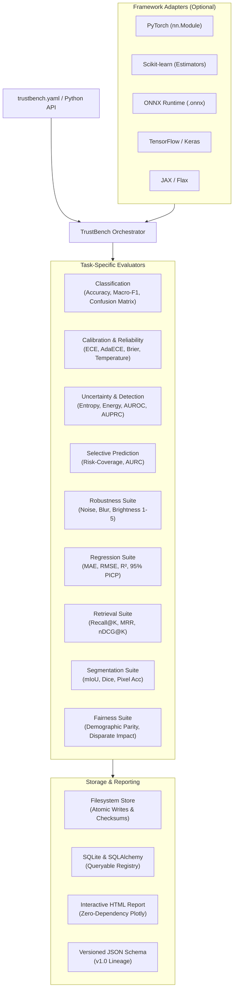

<div align="center">

# TrustBench

**ML Reliability, Robustness, Uncertainty & Fairness Evaluation Framework**

[](https://pypi.org/project/trustbench/)
[](https://pypi.org/project/trustbench/)
[](https://github.com/Uni-Creator/trustbench/blob/main/LICENSE)
[](https://github.com/Uni-Creator/trustbench/actions/workflows/ci.yml)
[](https://uni-creator.github.io/trustbench/)
[](https://github.com/Uni-Creator/trustbench/tree/main/tests)

</div>

---

TrustBench is a framework-independent machine learning evaluation library designed to measure how reliable models remain under distribution shifts, input corruptions, calibration failures, and algorithmic bias.

Traditional model evaluation focuses almost exclusively on accuracy. TrustBench investigates whether models remain reliable in deployment:
- **Calibration**: Does predicted confidence reflect the true probability of correctness?
- **Robustness**: How gracefully does performance degrade under physical, digital, and environmental corruptions?
- **Uncertainty & Error Detection**: Can predictive entropy and free energy identify incorrect predictions before downstream failures occur?
- **Selective Prediction**: What error rate is achieved when models defer low-confidence decisions?
- **Multi-Framework**: Evaluate PyTorch, Scikit-learn, ONNX Runtime, TensorFlow/Keras, and JAX models using identical contracts.
- **Multi-Task**: Native evaluators for Classification, Regression, Information Retrieval, and Semantic Segmentation.

---

## Architecture Overview



---

## Installation

TrustBench features a lightweight core with optional framework groups:

```bash
# Core installation (NumPy, SciPy, Scikit-learn, Click, Pydantic)
pip install trustbench

# For PyTorch model evaluation
pip install "trustbench[pytorch]"

# For ONNX Runtime inference
pip install "trustbench[onnx]"

# Full installation (all frameworks, storage, and visualization)
pip install "trustbench[all]"
```

See the [Installation Guide](https://github.com/Uni-Creator/trustbench/blob/main/docs/installation.md) for detailed platform requirements.

---

## 5-Minute Quickstart

### 1. Command Line Interface (CLI)

```bash
# Initialize a starter configuration
trustbench init

# Validate configuration paths and settings
trustbench validate trustbench.yaml

# Run evaluation and generate reports
trustbench evaluate trustbench.yaml
```

### 2. Python API

```python
import numpy as np
from sklearn.linear_model import LogisticRegression
from trustbench import TrustBench, InMemoryDatasetAdapter

# 1. Train or load your model
X_train = np.random.randn(200, 4)
y_train = np.random.randint(0, 2, size=200)
clf = LogisticRegression().fit(X_train, y_train)

# 2. Prepare test dataset
X_test = np.random.randn(50, 4)
y_test = np.random.randint(0, 2, size=50)
dataset = InMemoryDatasetAdapter(inputs=X_test, labels=y_test)

# 3. Evaluate reliability
bench = TrustBench(model=clf, dataset=dataset)
result = bench.evaluate()

print(f"Accuracy:    {result.metrics['classification']['accuracy']:.2%}")
print(f"Brier Score: {result.metrics['calibration']['brier_score']:.4f}")
print(f"ECE:         {result.metrics['calibration']['ece']:.4f}")
```

---

## Multi-Task Evaluation

### Continuous Regression Evaluation
```python
from trustbench import evaluate_regression, InMemoryDatasetAdapter
from sklearn.linear_model import Ridge
import numpy as np

model = Ridge().fit(X_train, y_train)
dataset = InMemoryDatasetAdapter(inputs=X_test, labels=y_test)

result = evaluate_regression(model, dataset)
print(f"MAE:  {result.metrics['mae']:.3f}")
print(f"RMSE: {result.metrics['rmse']:.3f}")
print(f"R²:   {result.metrics['r2']:.3f}")
```

### Information Retrieval Evaluation
```python
from trustbench import evaluate_retrieval

ground_truth = {"q1": ["docA", "docB"], "q2": ["docC"]}
retrieved = {"q1": ["docA", "docX", "docB"], "q2": ["docY", "docC"]}

res = evaluate_retrieval(ground_truth, retrieved, k_list=(1, 3))
print(f"MRR:      {res.metrics['mrr']:.3f}")
print(f"Recall@1: {res.metrics['recall@1']:.3f}")
print(f"nDCG@3:   {res.metrics['ndcg@3']:.3f}")
```

### Semantic Segmentation Evaluation
```python
from trustbench import evaluate_segmentation

result = evaluate_segmentation(segmentation_model, segmentation_dataset, num_classes=21)
print(f"Mean IoU:       {result.metrics['miou']:.3f}")
print(f"Dice (F1):      {result.metrics['dice']:.3f}")
print(f"Pixel Accuracy: {result.metrics['pixel_accuracy']:.2%}")
```

---

## Key Metrics Reference

| Category | Metrics Implemented |
|---|---|
| **Classification** | Accuracy, Balanced Accuracy, Precision, Recall, Macro-F1, Confusion Matrix |
| **Calibration** | Expected Calibration Error (ECE), Adaptive ECE, Maximum Calibration Error (MCE), Brier Score, NLL |
| **Uncertainty** | Predictive Shannon Entropy, Maximum Softmax Probability (MSP), Free Energy |
| **Error Detection** | AUROC, AUPRC, False Positive Rate at 95% TPR (FPR@95%TPR), Minimum Detection Error |
| **Selective Prediction** | Risk-Coverage Trade-off Curves, Area Under Risk-Coverage (AURC), Excess AURC |
| **Robustness** | Gaussian Noise, Blur, Brightness, Defocus, Contrast, Corrupted Accuracy Drop |
| **Regression** | MAE, MSE, RMSE, $R^2$, MedAE, MAPE, Max Error, 95% Interval Coverage (PICP, MPIW) |
| **Retrieval** | Mean Reciprocal Rank (MRR), Mean Average Precision (MAP), Recall@K, Precision@K, nDCG@K |
| **Segmentation** | Mean IoU (mIoU), Dice (F1), Pixel Accuracy, Frequency-Weighted IoU (FWIoU) |
| **Fairness** | Demographic Parity Difference, Disparate Impact Ratio, Equalized Odds Difference |

See [Metrics Documentation](https://github.com/Uni-Creator/trustbench/blob/main/docs/metrics.md) for mathematical derivations.

---

## Tutorials & Examples

Ready-to-run examples are available in the [`examples/`](https://github.com/Uni-Creator/trustbench/tree/main/examples) directory:

1. **[01_evaluate_pytorch_model.py](https://github.com/Uni-Creator/trustbench/blob/main/examples/01_evaluate_pytorch_model.py)**: Evaluate custom PyTorch `nn.Module`.
2. **[02_evaluate_cifar10.py](https://github.com/Uni-Creator/trustbench/blob/main/examples/02_evaluate_cifar10.py)**: End-to-end CIFAR-10 ResNet evaluation via configuration.
3. **[03_robustness_benchmark.py](https://github.com/Uni-Creator/trustbench/blob/main/examples/03_robustness_benchmark.py)**: Evaluate accuracy degradation across noise & corruptions.
4. **[04_analyze_calibration.py](https://github.com/Uni-Creator/trustbench/blob/main/examples/04_analyze_calibration.py)**: Compute ECE and fit validation temperature scaling.
5. **[05_evaluate_uncertainty.py](https://github.com/Uni-Creator/trustbench/blob/main/examples/05_evaluate_uncertainty.py)**: Predict error detection AUROC and risk-coverage curves.
6. **[06_compare_checkpoints.py](https://github.com/Uni-Creator/trustbench/blob/main/examples/06_compare_checkpoints.py)**: Quantify statistical differentials between model checkpoints.
7. **[07_save_and_reproduce_experiment.py](https://github.com/Uni-Creator/trustbench/blob/main/examples/07_save_and_reproduce_experiment.py)**: Atomic experiment persistence and checksum verification.
8. **[08_create_custom_metric.py](https://github.com/Uni-Creator/trustbench/blob/main/examples/08_create_custom_metric.py)**: Register custom evaluation scoring functions.
9. **[09_create_custom_model_adapter.py](https://github.com/Uni-Creator/trustbench/blob/main/examples/09_create_custom_model_adapter.py)**: Implement the runtime `ModelAdapter` protocol.

---

## Documentation

Full documentation is available on the [Documentation Website](https://uni-creator.github.io/trustbench/) or in the [`docs/`](https://github.com/Uni-Creator/trustbench/tree/main/docs) directory:
- [Installation Guide](https://github.com/Uni-Creator/trustbench/blob/main/docs/installation.md)
- [Quickstart Guide](https://github.com/Uni-Creator/trustbench/blob/main/docs/quickstart.md)
- [Python API Reference](https://github.com/Uni-Creator/trustbench/blob/main/docs/api.md)
- [CLI Reference](https://github.com/Uni-Creator/trustbench/blob/main/docs/cli.md)
- [Configuration Guide](https://github.com/Uni-Creator/trustbench/blob/main/docs/configuration.md)
- [Model Adapters](https://github.com/Uni-Creator/trustbench/blob/main/docs/model-adapters.md)
- [Dataset Adapters](https://github.com/Uni-Creator/trustbench/blob/main/docs/dataset-adapters.md)
- [Metrics Documentation](https://github.com/Uni-Creator/trustbench/blob/main/docs/metrics.md)
- [Robustness Testing](https://github.com/Uni-Creator/trustbench/blob/main/docs/robustness.md)
- [Experiment Tracking](https://github.com/Uni-Creator/trustbench/blob/main/docs/experiments.md)
- [Reporting & Visualization](https://github.com/Uni-Creator/trustbench/blob/main/docs/reporting.md)
- [Plugin Development](https://github.com/Uni-Creator/trustbench/blob/main/docs/plugins.md)
- [Troubleshooting & FAQ](https://github.com/Uni-Creator/trustbench/blob/main/docs/troubleshooting.md)

---

## Contributing

We welcome contributions! Please see [CONTRIBUTING.md](https://github.com/Uni-Creator/trustbench/blob/main/CONTRIBUTING.md) and our [Code of Conduct](https://github.com/Uni-Creator/trustbench/blob/main/CODE_OF_CONDUCT.md).

```bash
# Run tests
pytest

# Check code style
ruff check .

# Static type analysis
mypy src/trustbench/core src/trustbench/reporting src/trustbench/metrics
```

---

## License

TrustBench is open-source software licensed under the [Apache License, Version 2.0](https://github.com/Uni-Creator/trustbench/blob/main/LICENSE).
